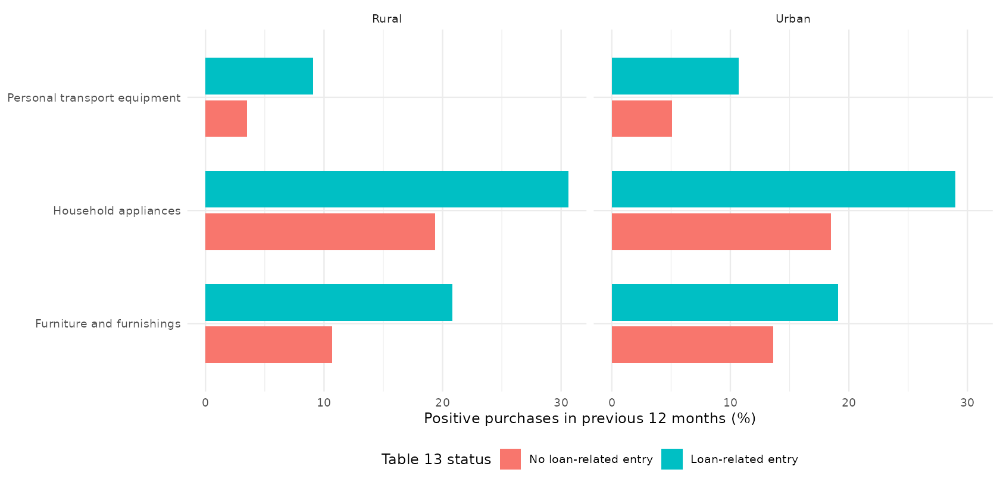
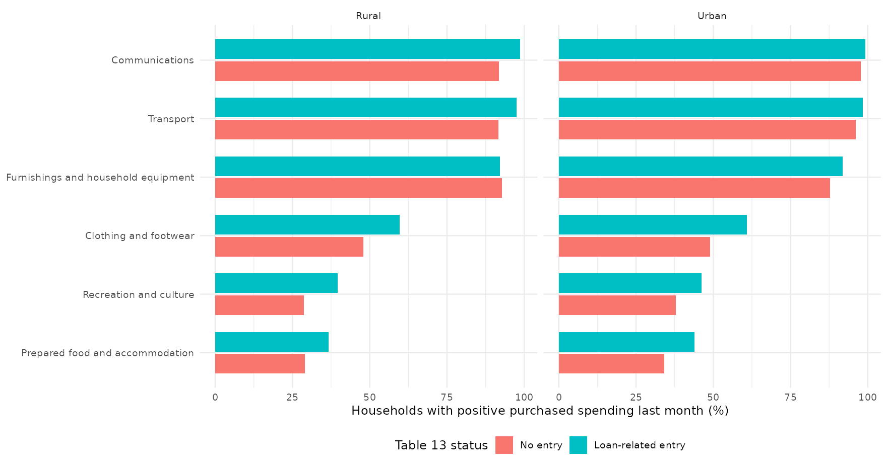

# Household Borrowing Reports and Durable-Goods Purchases

## Abstract

Using the 1393 Household Expenditure and Income Survey (2014–15), we examine household reports of loan-related financial-service entries and the relationship with expenditures on selected durable goods. The underlying expenditure workbooks contain 38,275 households, of which 5,848 have at least one loan-related Table 13 entry. The survey-weighted national reporting rate is 13.69%. Loan-entry reporting and purchases of furnishings, appliances, and personal transport equipment are positively associated conditional on expenditure position and observed household characteristics. These results are descriptive; loan reports do not measure all credit access, and the analysis cannot identify financing or causal effects.

## 1. Survey data and measurement

The original Access roster includes 39,856 household records, while the corresponding distributed rural and urban summary workbooks contain 38,275. The survey's Part 3, Table 13 includes 6,053 loan-associated financial-service records for 5,848 distinct households. Every such household matches the expenditure workbooks. The source is pinned to a fixed Git commit and SHA-256 hashes.

The two loan-related item codes are **126111** (housing) and **126112** 
(non-housing). The survey records a loan amount, a free-text financing 
source, and a financial-service charge. We define **loan-entry reporting** 
as the presence of at least one such item. No entry means no recorded 
**entry of this type**, not necessarily no borrowing or outstanding debt.

Our principal expenditure outcomes use Table 13 purchases recorded over 
the **previous 12 months**: code families **051** (furniture and furnishings), 
**053** (household appliances), and **071** (personal transport equipment). 
Purchased records have acquisition method 1, and reported gross nominal 
purchase amounts are not netted against sales of used items. The shared 
recall window is preferable to comparing an annual loan report directly 
with one month of occasional durable purchases.

## 2. Descriptive results

### Loan-related reporting

| Residence | Households | Reporting households | Weighted reporting rate |
| --- | ---: | ---: | ---: |
| Rural | 19,390 | 2,530 | 11.29% |
| Urban | 18,885 | 3,318 | 14.55% |
| All | 38,275 | 5,848 | 13.69% |

### Durable-purchase participation over the previous 12 months

The next table reports weighted percentages of households with positive 
gross purchases. The two groups are households **without** and **with** 
a recorded loan-related financial-service entry.

| Category | Residence | No entry | Entry | Difference (pp) |
| --- | --- | ---: | ---: | ---: |
| Furniture and furnishings | Rural | 10.67% | 20.81% | 10.15 |
| Furniture and furnishings | Urban | 13.60% | 19.11% | 5.51 |
| Household appliances | Rural | 19.38% | 30.61% | 11.22 |
| Household appliances | Urban | 18.47% | 28.99% | 10.52 |
| Personal transport equipment | Rural | 3.50% | 9.09% | 5.59 |
| Personal transport equipment | Urban | 5.06% | 10.68% | 5.62 |

## 3. Conditional associations

We estimate survey-weighted logistic models for the presence of each 
selected annual purchase category and for any such purchase. These models 
adjust for weighted quartiles of annual expenditure per household member, 
rural/urban residence, household-head age, gender, literacy, and the 
logarithm of household size. The adjusted odds ratios for loan-entry 
reporting are:

| Annual purchase outcome | Odds ratio | 95% interval (weights-only) | 95% interval (province clusters) | Cluster BH-adjusted p |
| --- | ---: | ---: | ---: | ---: |
| Furniture and furnishings | 1.25 | 1.12–1.40 | 1.05–1.51 | 0.017 |
| Household appliances | 1.51 | 1.37–1.66 | 1.09–2.08 | 0.017 |
| Personal transport equipment | 1.60 | 1.35–1.88 | 1.34–1.90 | <0.001 |
| Any selected durable group | 1.49 | 1.36–1.63 | 1.15–1.93 | 0.009 |

These province-clustered intervals treat provinces as clusters and
use t-based critical values with the fitted model residual degrees
of freedom. The estimates are a variance sensitivity check rather than
an official reconstruction of the HEIS sampling design.

The baseline weighted logit for loan-entry reporting itself finds a positive conditional association for the highest versus lowest expenditure-per-person quartile (OR 3.32, 95% interval 2.85–3.86). A province-adjusted version gives OR 5.34. These are distinct adjusted specifications, not a causal gradient.

In a secondary weighted linear model, reported loan-entry status is associated with a food budget share -1.19 percentage points lower conditional on the baseline controls; the province-adjusted specification gives -1.98 percentage points. Food share and total expenditure are mechanically related, and both may be endogenous to household financial decisions.

### Measurement and expenditure-control sensitivity

Because annual total expenditure includes some of the purchases being
modeled, the baseline quartile control may mechanically overlap with
the dependent variable. An additional specification subtracts gross
purchases in code families 051, 053, and 071 before computing weighted
expenditure-per-person quartiles. This is an accounting sensitivity,
not a validated measure of nondurable expenditure, income, or wealth.
The same eligible households are used to compare the total and
leave-out expenditure controls.

The leave-out comparison retains 38,275 households; 0 are excluded by the leave-out or control-variable requirements.

| Annual outcome | Total-expenditure OR (same sample) | Leave-out OR | Province-clustered 95% interval (leave-out) |
| --- | ---: | ---: | ---: |
| Furniture and furnishings | 1.25 | 1.32 | 1.10–1.59 |
| Household appliances | 1.51 | 1.56 | 1.14–2.13 |
| Personal transport equipment | 1.60 | 1.89 | 1.67–2.15 |
| Any selected durable group | 1.49 | 1.58 | 1.26–1.98 |

As a distinct measurement check, households are classified into four
mutually exclusive groups: no loan-related entry, housing-only,
non-housing-only, or both types. Housing-only and non-housing-only
associations are estimated separately against households without an
entry. These are not comparisons with verified nonborrowers.

| Residence | Reported loan-item group | Households | Weighted group share |
| --- | --- | ---: | ---: |
| Rural | Both types | 36 | 0.14% |
| Rural | Housing only | 257 | 1.13% |
| Rural | No recorded entry | 16,860 | 88.71% |
| Rural | Non-housing only | 2,237 | 10.02% |
| Urban | Both types | 80 | 0.41% |
| Urban | Housing only | 299 | 1.43% |
| Urban | No recorded entry | 15,567 | 85.45% |
| Urban | Non-housing only | 2,939 | 12.71% |

For the combined durable-purchase outcome, the alternative comparisons are:

| Loan-report comparison | Leave-out adjusted OR | 95% interval (weights-only) |
| --- | ---: | ---: |
| Non-housing only vs no entry | 1.64 | 1.50–1.81 |
| Housing only vs no entry | 1.08 | 0.82–1.42 |

The control-substitution exercise does not remove selection bias,
prove that a loan paid for a purchase, or identify a causal effect.
Province clustering remains a sensitivity approximation rather than
the official survey design.

### Additional monthly purchase categories

The questionnaire separately records previous-month spending on clothing 
and footwear, furnishings, transport, communications, recreation and 
culture, and prepared food and accommodation. The repo reports weighted 
participation and expenditure for each. These **monthly** observations 
are neither an exhaustive annual consumption basket nor a decomposition 
of full annual expenditures.

## 4. Financial intermediation and measurement issues

The loan-record financing-source field is nonempty in approximately 96.46% of records. An exploratory text rule identifies explicit bank names, recognizable bank shorthand, funds/other institutions, and ambiguous responses. This is not a verified market-share classification.

The two loan-charge types have a notable concentration of the reported charge-to-amount ratio at **2.5%** (for the dominant share of records), so these charges must not be interpreted as contractual loan interest rates, APRs, or effective borrowing costs. The original questionnaire is the interpretive basis for the relevant item codes and fields.

## 5. Design limitations

1. The credit variable records a particular annual fee-linked loan item, 
**not complete credit access, outstanding debt, loan origination, or approval**.
2. The data are a single cross-section. Credit selection, omitted wealth 
and preferences, and simultaneity prevent causal interpretation.
3. A positive annual durable-purchase record cannot be linked to a 
particular loan or lender, even when the household reports both.
4. Sample weights are applied, but the original stratification and 
PSU structure have not been established. Reported regression standard 
errors and 95% intervals use a **weights-only, independent-household** 
approximation and are not fully design-consistent.
5. The questionnaire's 12-month and monthly components are reported 
separately. Monthly purchases, especially infrequent durables, must 
not be annualized mechanically.
6. Financial-source coding uses free text and transparent heuristics.

## 6. Reproducibility

The analysis retrieves the three pinned survey archives from the 
unchanged companion repository, checks their SHA-256 hashes, validates 
survey record counts, and runs in a locked Pixi/R environment. 
The GitHub Actions workflow re-estimates the models and verifies that 
all aggregate figures and tables exist. No record-level identifiers 
or household microdata are published in the results.

- [Detailed methodology](../docs/METHODOLOGY.md)
- [Reproducibility instructions](../README.md)
- [Aggregate model coefficients](tables/regression_coefficients.csv)
- [Annual durable outcomes](tables/annual_durable_purchase_associations.csv)
- [Comparable expenditure-control sensitivities](tables/borrowing_measurement_and_control_sensitivity.csv)
- [Exclusive loan-report classifications](tables/exclusive_loan_reporting_groups.csv)
- [Monthly sector outcomes](tables/sector_purchase_associations.csv)
- [Financing-source diagnostics](tables/financing_source_groups.csv)

*Note: This is a descriptive empirical research sample, not an estimate 
of the causal effects of borrowing or monetary policy.*
